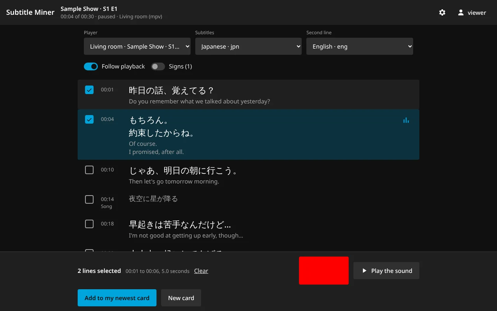
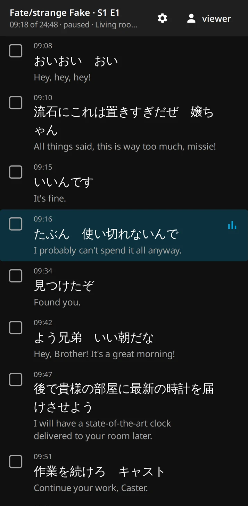
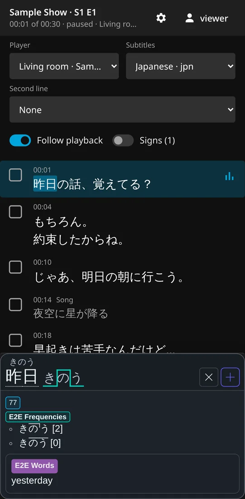
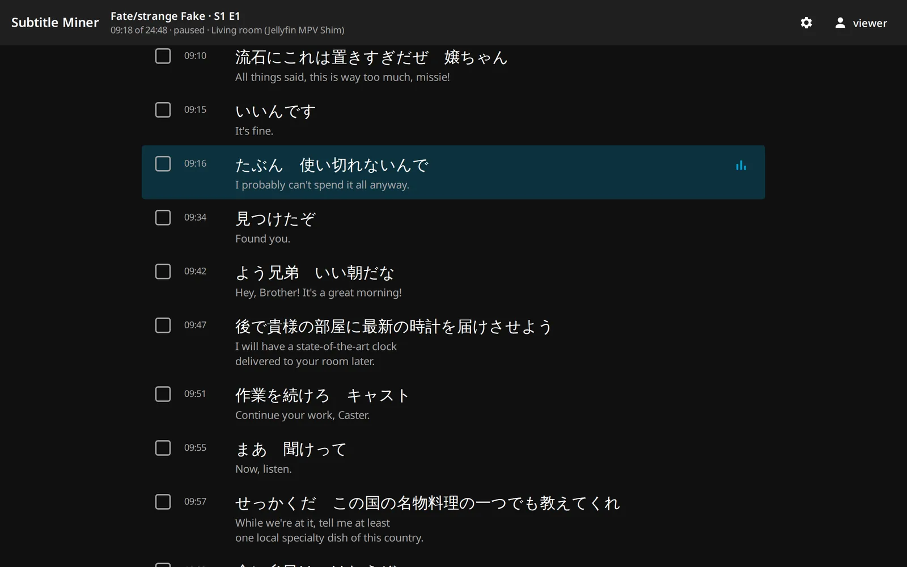
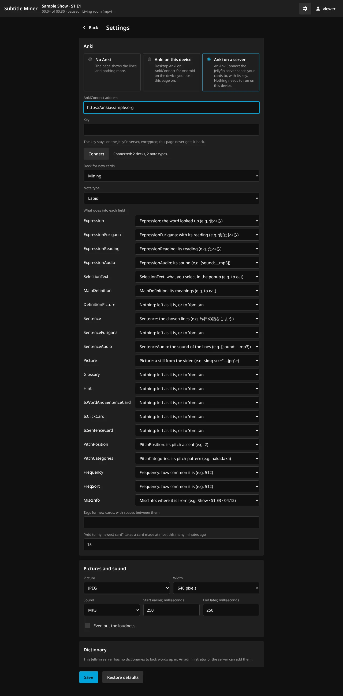
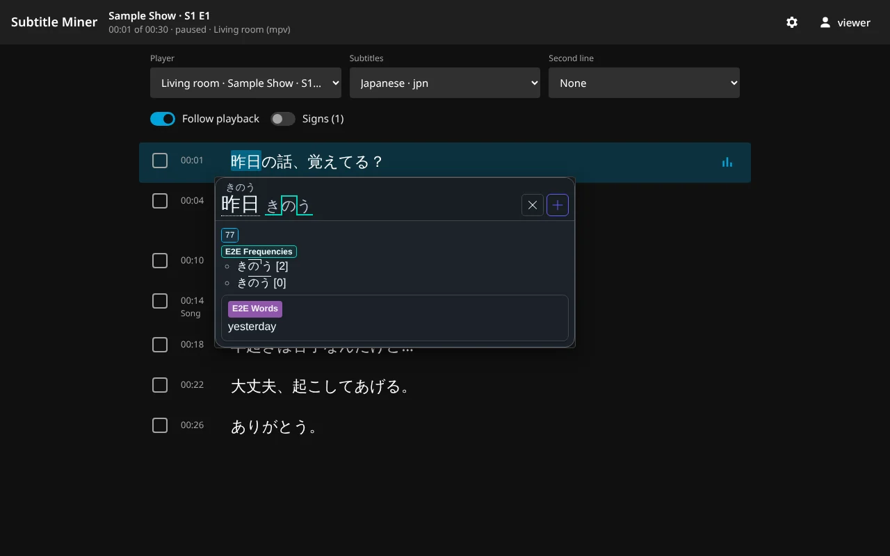

# Subtitle Miner for Jellyfin

Watch on any Jellyfin client (TV, mobile, web) and make Anki cards from the subtitles on any device, with the sentence, a picture and the audio cut from the video. Mining from your couch.

Only watching locally with mpv? Check out [mpv-subtitleminer](https://github.com/friedrich-de/mpv-subtitleminer) instead.



## What it does

- **Follows what you play.** Start an episode on your TV, phone or any other Jellyfin app, and open the page on another device. It shows the subtitle lines as they are spoken and keeps up when you pause, jump or change the track. Scroll back to read, and one tap takes you to the line playing again. Episodes and films you watched in the last 12 hours stay listed, so you can still mine from them afterwards.
- **Reads the subtitles itself.** ASS, SRT and WebVTT, next to the video or inside it. The Japanese track is picked for you, a second track can be shown under each line for its meaning, and signs and songs are told apart from what people say.
- **Makes Anki cards.** Pick one line or several in a row, see the picture and hear the sound the card will get, then either add them to the card you just made with Yomitan, or make a new card. The picture and the sound are cut from the video on the Jellyfin server.
- **Looks words up.** Tap a word in a line, or hold Shift over it as with Yomitan, and a popup shows it from Yomitan dictionaries kept on the Jellyfin server, with conjugations undone, frequencies and pitch accents. Its + button makes a card of the word, its reading, meaning, frequency, pitch and sound, the sentence, the picture and the sound of the line. Select part of a definition first, and only that goes into SelectionText. No browser extension is needed, so it works on a phone too.
- **No extra sign-in.** The page uses your Jellyfin login. Where the browser has none, it asks for your Jellyfin name and password once.
- **Installs as an app** on a phone, tablet or computer, from the browser's menu.

<p>
  
  
</p>

Looking a word up and making a card of it, with Jitendex:



## Install

You need Jellyfin 12.4 or later.

1. In Jellyfin, open the Dashboard, then Plugins, then Repositories, and add this address:

   ```text
   https://raw.githubusercontent.com/friedrich-de/jellyfin-subtitleminer/main/repository/manifest.json
   ```

2. Install **Subtitle Miner** from the Catalog, and restart Jellyfin.
3. Open the page at your Jellyfin address followed by `/SubtitleMiner/`, for example `http://192.168.1.10:8096/SubtitleMiner/`.

Every user of your Jellyfin server can use the page with their own login and settings. Their settings are kept on the server, so they follow them from device to device.

## Making cards

In the page's settings, choose where your cards go:

- **Anki on this device.** Desktop Anki with [AnkiConnect](https://ankiweb.net/shared/info/2055492159), or AnkiConnect for Android, on the device you open the page on. AnkiConnect has to let the page in: the settings show the line to add to `webCorsOriginList` in AnkiConnect's config.
- **Anki on a server.** An AnkiConnect that the Jellyfin server can reach, with its API key. The Jellyfin server sends the cards, the pictures and the sound there for you, so nothing needs to run on the device you mine on. The key stays on the Jellyfin server, encrypted, and only the calls that read, add and fill in notes are passed on, never ones that delete. Because the Jellyfin server then calls whatever address is typed in, only administrators may use this until an administrator ticks "Let users who are not administrators send cards through this server".

Then choose the deck and the note type. If you use [Lapis](https://github.com/donkuri/lapis) (or Kiku, or a copy of either under another name), it is chosen for you the first time you connect, with the deck its newest card is in and every field filled as Lapis means it. For other note types, what goes into each field is guessed from the field names, which works for most mining note types. Each choice is named as Lapis names its field, such as "ExpressionReading: its reading (e.g. たべる)", and can be changed. "Restore defaults" puts every choice back as it was the first time, Lapis included, and keeps where your cards go.

There are two ways to make a card from the lines you picked:

- **Add to my newest card**: make the card with your own Yomitan first, then this adds the sentence, the picture and the sound to it, keeping the word Yomitan marked. The page names the card it will change, such as "Adds to "約束", made a minute ago.", and greys the button out when there is none it may take. It only takes a card made in the last 15 minutes (you can change that), and Undo puts the card back as it was.
- **New card**: makes a card of the lines in your deck. In the dictionary popup, the + button makes one of the word.

Once the card has them, the lines are unselected, ready for the next one; Undo stays at the bottom until you choose other lines.

Cards reach AnkiWeb when your Anki next syncs. To send them right away, press **Sync Anki now**, the round arrows in the top bar: your Anki, on the server or on the device, syncs with AnkiWeb at once, and the page says how it went.



## The dictionary

No dictionary comes with the plugin. An administrator adds them in the page's settings: Jitendex and JMnedict with one tap, or any Yomitan dictionary from an address or from files, several at once if you like. The Jellyfin server imports them one after another, each in a few seconds (Jitendex in 2 to 4), and keeps them for everyone. Dictionaries can be put in order, turned off and removed. Importing a dictionary that is there already puts the new import in its place.

If a dictionary's small pictures, such as Daijirin's labels 漢 and 文, say "Image failed to load", it was imported by a version before 2.1.0.1, which kept pictures with Shift-JIS names in the zip under names no definition asks for. Import it once more.

Frequency and pitch accent dictionaries in Yomitan's format work as well, such as Kanjium's pitch accents. The popup then shows a word's pitch, and a card gets it in PitchPosition (the mora the pitch falls after, such as 2) and PitchCategories (heiban, atamadaka, nakadaka, odaka or kifuku, as Yomitan names them).

Each user can turn looking up off in their settings, for example to keep using their own Yomitan with "Add to my newest card". There, too, they can make the popup's text smaller or larger, hide the tags (★, the dictionary's name, parts of speech and the like), and lay definitions out compactly, each meaning on one line as in Yomitan's compact glossaries. On a phone the popup stays inside the part of the page you see, also when you have zoomed in.

For the sound of words, an administrator gives the address of an audio source in the same settings, as Yomitan's "Custom URL (JSON)" takes it, with `{term}` and `{reading}` where the word and its reading go, for example `https://example.org/audio/list?term={term}&reading={reading}`. The Jellyfin server fetches the sounds from there, so the address and any key in it stay on the server. The popup then has a play button, and a word's card gets its sound in ExpressionAudio. As in Yomitan, holding the play button (or right-click, or Shift-click) lists the sounds the source has for the word; the one you choose plays from then on and is the one the card gets.



## Installing it as an app

Open the page and choose "Install" or "Add to home screen" in the browser's menu. Browsers only offer this when Jellyfin is opened over HTTPS (or on the computer Jellyfin runs on, at `localhost`). The app keeps only the page's own files, never subtitles, pictures, sound or settings, and says so when it cannot reach your server.

## Coming from version 1

Version 2 is a rewrite. Version 1 (1.1.0.1, called Jellyfin Miner) is for Jellyfin 10.11 and is no longer developed. Its sign-in does not work on Jellyfin 12, because Jellyfin 12 no longer reads the header it sends.

- On Jellyfin 12.4 or later, add the repository address above and install Subtitle Miner. It has the same plugin id as version 1 and takes its place.
- On Jellyfin 10.11, keep version 1. Its address, `https://friedrich-de.github.io/jellyfin-subtitleminer/manifest.json`, still offers it, and its source and README are at the tag [v1.1.0.1](https://github.com/friedrich-de/jellyfin-subtitleminer/tree/v1.1.0.1).
- The page of version 1, `/Plugins/JellyfinMiner/`, leads to the new one. Version 1's settings are not carried over, so choose where your cards go once more.

[CHANGELOG.md](CHANGELOG.md) lists what changed.

## Development

The plugin is C# for .NET 10 in `Jellyfin.Plugin.SubtitleMiner/`. The page is Vue and TypeScript in `web/`; its build is embedded in the plugin's one DLL.

You need the .NET 10 SDK, Node.js 22 or newer, `zip`, Python 3 and, for the end-to-end tests, ffmpeg.

```sh
# The plugin: build (warnings are errors) and unit tests
dotnet build -c Release
dotnet test -c Release

# The page: types, lint, formatting and unit tests
cd web && npm ci && npm run check

# The package Jellyfin installs: dist/subtitle-miner_<version>.zip and dist/manifest.json
dev/package.sh

# Dictionaries of your own against the importer, outside Jellyfin: what each import counted
# and whether every picture its definitions ask for is there
SUBTITLE_MINER_DICTIONARIES=<folder of zips> dotnet test --project Jellyfin.Plugin.SubtitleMiner.Tests -c Release -- --filter-class "*RealDictionaryTests"

# End to end: a throwaway Jellyfin 12.4 with the package installed through Jellyfin's own
# plugin installer, then the plugin's addresses over HTTP and the page in a real browser
# at desktop and at phone size
dev/e2e.sh
```

`dev/e2e.sh` downloads the Jellyfin server once into `.cache/` (about 110 MB, x86-64 Linux) and needs Playwright's Chromium (`cd web && npx playwright install chromium`). The top of the script says how to use an installed server instead. The tests make their own videos with ffmpeg (colours that change every five seconds, a hum on each audio track, subtitles inside and next to the video), play them with a pretend player through Jellyfin's own playback calls, send cards to a pretend AnkiConnect, and keep the server off the internet. `SUBTITLE_MINER_E2E_SCREENS=<folder> dev/e2e.sh screens` takes pictures of the page with the test media. The pictures in `docs/screenshots/` were taken on a real Jellyfin playing Fate/strange Fake.

The dictionary check is the tool for a dictionary that does not import or shows no pictures. It fails with what it found, and writes the same to the file `SUBTITLE_MINER_DICTIONARIES_REPORT` names. A dictionary's zip is read as Yomitan reads it, because real dictionaries count on it: a file's name that the packer wrote in its own encoding (Shift-JIS on a Japanese Windows) is taken from the "Unicode Path" field beside it (`Dictionary/ZipNames.cs`), and a checksum that does not fit refuses nothing as long as the file unpacks whole, since some dictionaries are packed with wrong ones.

To work on the page against a Jellyfin that has the plugin installed: `cd web && JELLYFIN_URL=http://localhost:8096 npm run dev`.

The app's icons in `web/public/icons/` are the plugin's pickaxe logo from version 1; `icon-512.png` is also the picture in Jellyfin's plugin catalog. The page's service worker (`web/src/worker/`) is built into `sw.js` with the list of the build's files, and keeps nothing else.

A release raises `<Version>` in `Directory.Build.props`, gives it a section in `CHANGELOG.md`, and runs `dev/package.sh --publish`, which adds the zip to `repository/` and the version to `repository/manifest.json`. Jellyfin reads that manifest from the main branch, so the version is out once that commit is on main.

Nothing runs on GitHub by itself. Whoever makes a change runs the checks above before merging.

## Philosophy

A lot of great tools for language learning and media mining exist, but they place the learner in artificial learning environments that they would not use if they weren't actively engaged in language learning. In my opinion, this is an issue. Immersion should be performed in the same environment as leisure media consumption. This plugin fixes that gap - watch shows as you would normally. Only when you want to mine a subtitle do you need to open the plugin interface, and you can do that on any device. Watch on TV, mine on mobile. Watch on desktop, mine on desktop. The choice is yours.

## Licence

GPL-3.0, see [LICENSE](LICENSE). Jellyfin plugins link Jellyfin's libraries, which are GPL-3.0.

The rules the dictionary uses to undo Japanese conjugations are [Yomitan](https://github.com/yomidevs/yomitan)'s, as the [Hoshidicts](https://github.com/bee-san/hoshidicts) Japanese language pack writes them (GPL-3.0-or-later); [Dictionary/Japanese/SOURCES.md](Jellyfin.Plugin.SubtitleMiner/Dictionary/Japanese/SOURCES.md) says where each file comes from. No dictionary comes with the plugin: an administrator downloads or uploads the ones they want, under their own licences.

The page shows words with [dictionary-popup](https://github.com/bee-san/dictionary-popup), [Hachidori](https://github.com/bee-san/hachidori)'s popup (GPL-3.0-or-later, its icons Fluent UI System Icons under MIT). A copy is in [web/src/vendor/dictionary-popup](web/src/vendor/dictionary-popup), changed only so that its styles pass the page's content policy, a card's state follows its word, its text can be made smaller or larger, and a word's sounds can be chosen from a list; its `SOURCES.md` says from where and what changed.
